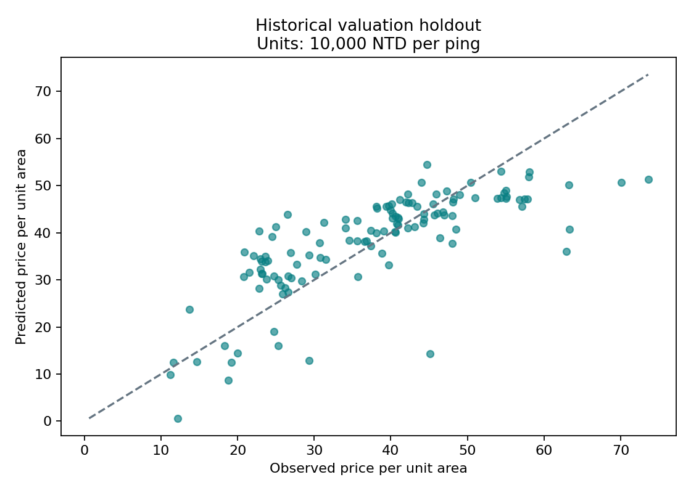

# Real Estate Valuation — Reproducible Regression Review

A historical-data regression case study using the UCI Real Estate Valuation dataset: 414 observations from the Sindian district of New Taipei City, Taiwan. The goal is to compare a transparent model with a simple baseline and explain the limits of its estimates.

## Holdout results

| Model | MAE | RMSE | R² |
|---|---:|---:|---:|
| Training median baseline | 10.7512 | 13.1190 | -0.0051 |
| Ridge regression | 6.4846 | 8.5331 | 0.5748 |

MAE and RMSE are in **10,000 New Taiwan dollars per ping**, the dataset's target units. They are not currency-per-property errors. A random historical holdout is not evidence of current UK, Indian or live-market valuation accuracy.

## Reproduce

Python 3.11+:

```bash
python -m pip install -r requirements.txt
python -m unittest discover -s tests -v
python train.py
```

Outputs: `reports/metrics.json`, `holdout_predictions.csv` and `holdout.png`.

## Method

Fixed 70/30 random split, seed 50, yields 289 training and 125 holdout rows. Imputation and standardisation are inside a scikit-learn pipeline. Ridge alpha is selected with five-fold training-only cross-validation on MAE; selected alpha is 1. The final model is compared once against a training-median DummyRegressor on the fixed holdout. The row identifier is excluded from features.

The three tests cover dataset contract, metric calculations and report generation with the baseline comparison. They do not establish deployment safety or performance on future data.



## Data attribution

Yeh, I. (2018). *Real Estate Valuation* [Dataset]. UCI Machine Learning Repository. https://doi.org/10.24432/C5J30W

Official source: https://archive.ics.uci.edu/dataset/477/real+estate+valuation+data+set . The dataset is distributed under CC BY 4.0; credit the original source and identify changes. The CSV filename is retained from the original repository. The new train/holdout evaluation and generated reports are additions; the source observations are not represented as newly collected data.

## Limitations and next decision

Historical 2012–2013 observations, a small geographically concentrated sample and a random split limit generalisation. There is no temporal, geographic or prospective deployment validation. Before using any model for a decision, obtain suitable licensed recent data, define the intended geography and test on an independent time period. Model output is an analytical estimate, not a professional valuation.

The original notebook and model_pickle remain as historical assets. The validated entrypoint is `train.py`; it does not load the legacy pickle. Results reproduced on 23 November 2026.
